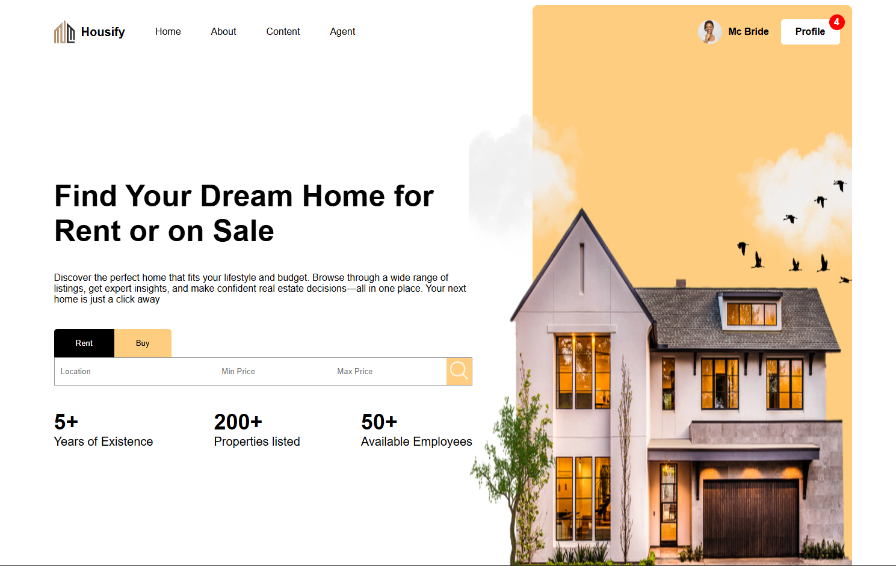
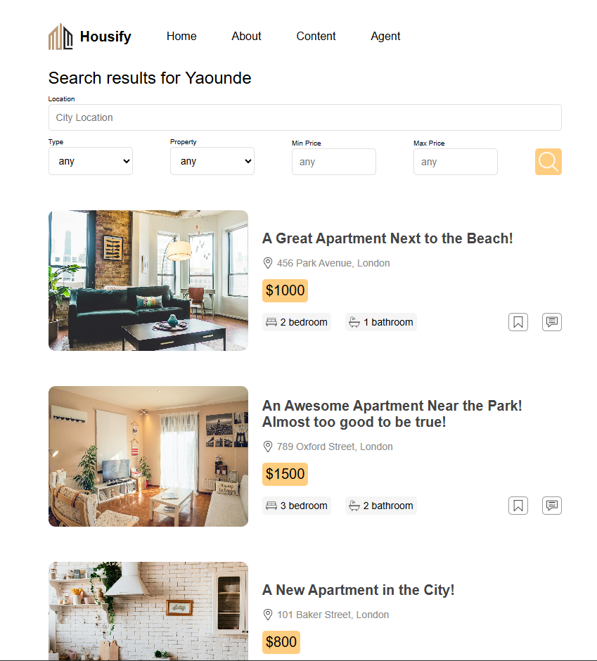
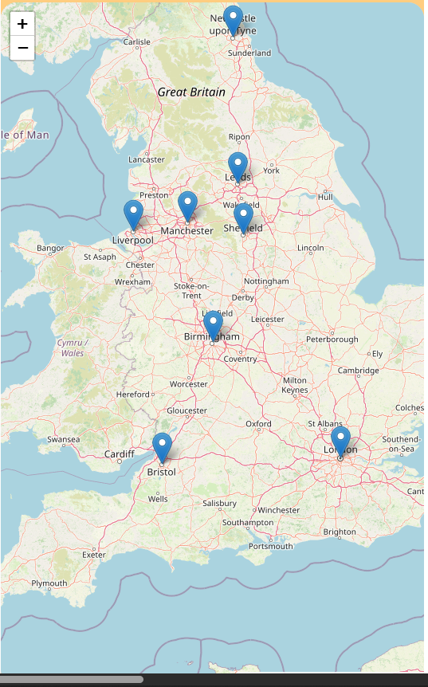

# 🏠 Housify  

[](https://react.dev/)  
[](https://sass-lang.com/)  
[](https://nodejs.org/)  
[](https://expressjs.com/)  
[](https://www.prisma.io/)  
[](https://leafletjs.com/)  

---

Housify is a web app that helps people **find houses to rent or buy**.  
Property owners can create accounts and list properties, while users can search by location, price, and category (rent/buy) and view results on an interactive map.  

---

## 🚀 Tech Stack  
- **Frontend:** React, Sass  
- **Backend:** Node.js, Express.js  
- **Database:** Prisma  
- **Maps:** Leaflet.js  

---

## ✨ Features  
- 🔑 User authentication  
- 🏠 Rent or Buy categories  
- 📍 Search by location & price range  
- 🗺️ Interactive map view with Leaflet.js  
- 📝 Property management for owners  

---

## 📸 Preview  

### 🔹 Homepage  
  

### 🔹 Property Listings  
  

### 🔹 Map View  
  


---

## ⚡ Getting Started  

```bash
# Clone repo
git clone https://github.com/your-username/housify.git

# Install dependencies
npm install

# Setup .env file
DATABASE_URL=your_prisma_db_url
JWT_SECRET=your_secret

# Run migrations
npx prisma migrate dev --name init

# Start dev server
npm run dev
